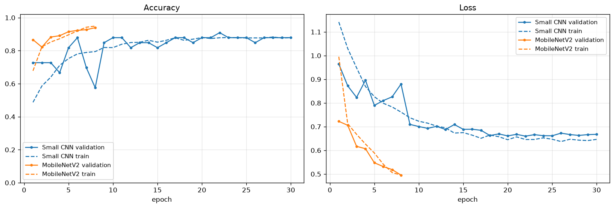
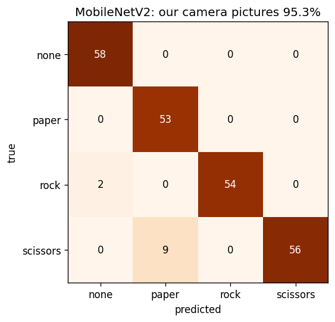

# Model comparison: small CNN vs MobileNetV2

Generated by the notebooks in `Models/`; do not edit by hand (it is overwritten).
Kaggle test: Kaggle `test/` folder, converted to grayscale like the camera.
Our camera test: our own OV7675 pictures in `data/test` (never used for training).

| Model | Kaggle test | Wrong | Our camera test | Best val | Parameters | Trained at start | Epochs | s/epoch | ms/picture |
|---|---|---|---|---|---|---|---|---|---|
| Small CNN | **88.4%** | 43/372 | not tested | 90.9% | 93,636 | 93,636 | 30 | 12 (cuda) | 3.4 |
| MobileNetV2 | **86.6%** | 50/372 | **95.3%** (232 pictures) | 93.9% | 2,388,356 | 164,484 | 8 | 52 (cuda) | 7.6 |

## Per class (test set)

| Model | Class | Precision | Recall |
|---|---|---|---|
| Small CNN | paper | 1.000 | 0.847 |
| Small CNN | rock | 0.761 | 0.952 |
| Small CNN | scissors | 0.946 | 0.855 |
| MobileNetV2 | paper | 1.000 | 0.621 |
| MobileNetV2 | rock | 0.992 | 0.976 |
| MobileNetV2 | scissors | 0.717 | 1.000 |

## Training curves, both models

## Small CNN

## MobileNetV2

## Conclusion

We will use **MobileNetV2 (transfer learning)** for the game.

- **Works on our camera:** trained on Kaggle plus 1,421 of our own OV7675 pictures from several rooms and
  sessions (including a "none" class for when no hand is shown), MobileNetV2 scores **95.3% on 232 camera
  pictures it never trained on**. Every "no hand" and paper picture was right; the mistakes were 9
  scissors called paper and 2 rocks called "none".
- **Our own pictures were necessary:** trained on Kaggle alone, the model guessed "paper" for almost
  everything the camera showed, including an empty scene. Kaggle's pictures are rendered hands on white
  backgrounds and have no "none" class.
- **Lighting and sessions matter:** with pictures from only one session per room, the model learned each
  session's lighting. It called 41 of 60 empty-room pictures from a different time of day "rock". Adding
  those pictures to training and randomly varying brightness, contrast and blur made it more robust.
- **Trade-off on Kaggle:** focusing on our camera lowered accuracy on Kaggle's rendered hands from 94.9%
  to 86.6% (it now often calls Kaggle's paper "scissors"). The game only sees our camera, so we accept this.
- **Versus the small CNN:** on Kaggle-only training, MobileNetV2 beat the small CNN trained from scratch
  (94.9% vs 88.4% on the Kaggle test set) and learned much faster thanks to pretrained ImageNet features.
- **Fast enough:** a prediction takes about 6 ms on a T4 GPU and 28 ms on a laptop CPU, small next to the
  camera, which delivers a new picture about every 400 ms (2.5 per second).

**Limitations:** the camera test set is small (232 pictures), comes from one person's hand, and partly
from the same sessions as training pictures, so accuracy in a new room or with other people is likely
lower. A fresh test set recorded in a separate session would give a more honest number. The small CNN has
not been retrained with our pictures.
