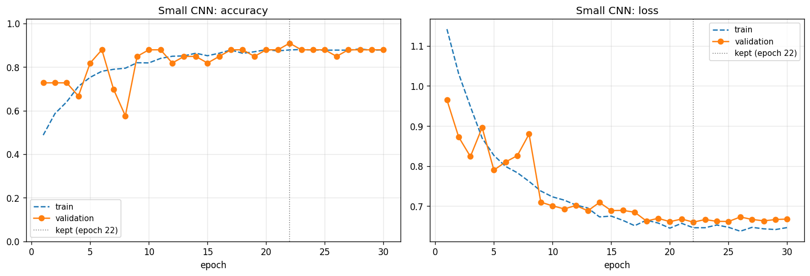
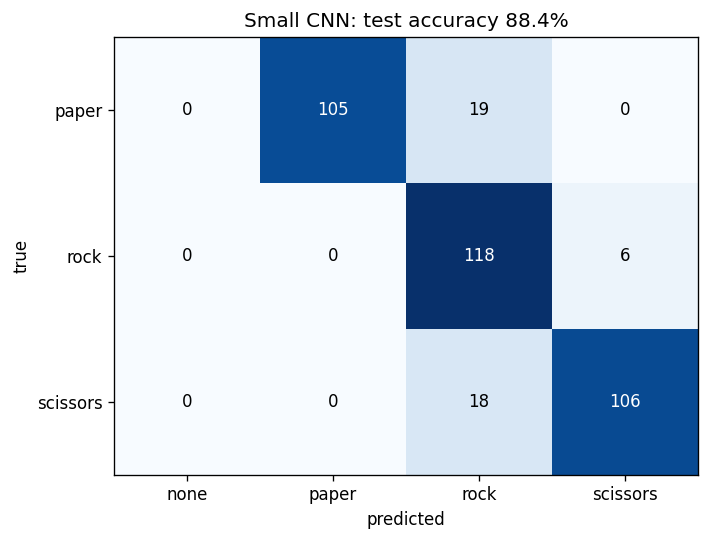
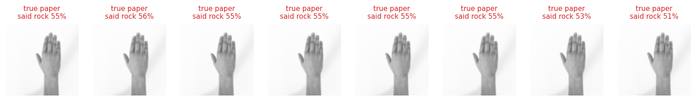
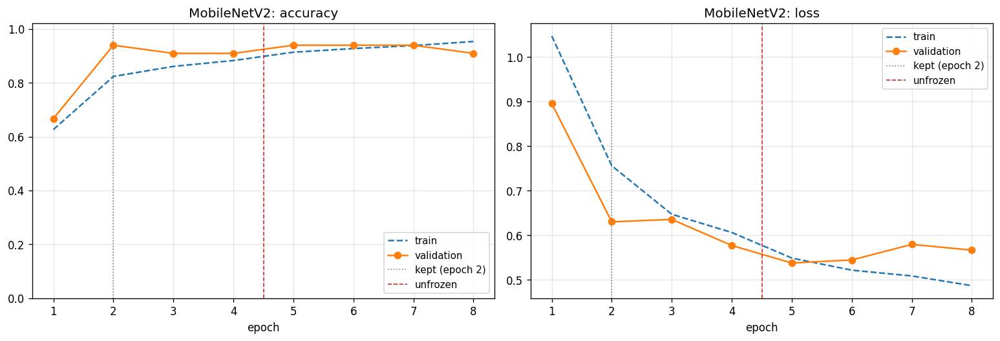
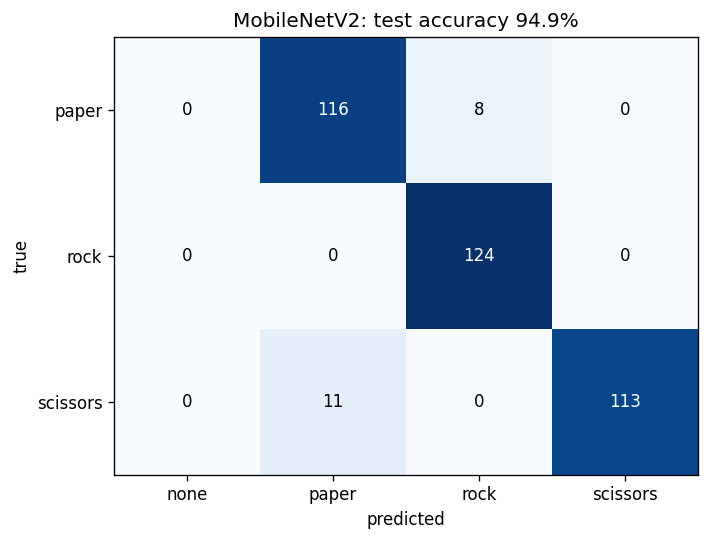
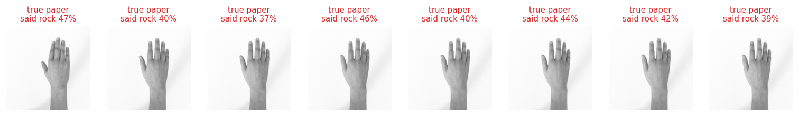

# Model comparison: small CNN vs MobileNetV2

Generated by the notebooks in `Models/`; do not edit by hand (it is overwritten).
Test set: Kaggle `test/` folder, converted to grayscale like the camera.

| Model | Test accuracy | Wrong | Best val | Parameters | Trained at start | Epochs | s/epoch | ms/picture |
|---|---|---|---|---|---|---|---|---|
| Small CNN | **88.4%** | 43/372 | 90.9% | 93,636 | 93,636 | 30 | 12 (cuda) | 3.4 |
| MobileNetV2 | **94.9%** | 19/372 | 93.9% | 2,388,356 | 164,484 | 8 | 24 (cuda) | 7.7 |

## Per class (test set)

| Model | Class | Precision | Recall |
|---|---|---|---|
| Small CNN | paper | 1.000 | 0.847 |
| Small CNN | rock | 0.761 | 0.952 |
| Small CNN | scissors | 0.946 | 0.855 |
| MobileNetV2 | paper | 0.913 | 0.935 |
| MobileNetV2 | rock | 0.939 | 1.000 |
| MobileNetV2 | scissors | 1.000 | 0.911 |

## Training curves, both models

## Small CNN

## MobileNetV2

## Conclusion

We will use **MobileNetV2 (transfer learning)** for the game.

- **More accurate:** 94.9% on the Kaggle test set (19 of 372 wrong), compared with 88.4% (43 wrong)
  for the small CNN trained from scratch.
- **Fewer systematic mistakes:** the small CNN over-predicts rock (precision 0.76, so about 1 in 4
  of its "rock" answers is wrong). MobileNetV2's weakest class is scissors (recall 0.91), and it never
  calls another gesture scissors (precision 1.00).
- **Learns faster:** pretrained ImageNet features let MobileNetV2 reach about 94% validation accuracy within
  2 epochs; the small CNN needed about 16 epochs to level off around 88%. Its training and validation
  accuracy stay close, so it is limited by its small size rather than overfitting.
- **Fast enough:** a prediction takes 7.7 ms on a T4 GPU (3.4 ms for the small CNN). Both are negligible
  next to the camera, which delivers a new frame every 400 ms (2.5 frames per second), so the larger model
  costs nothing noticeable in the game.

**Limitation:** both models were tested on Kaggle's computer-rendered hands on white backgrounds,
converted to grayscale. The next step is to test MobileNetV2 on our own OV7675 camera pictures
(`data/test/`) and, if needed, fine-tune it on pictures we capture ourselves (`data/ours/`),
including a "none" class for when no hand is shown.
